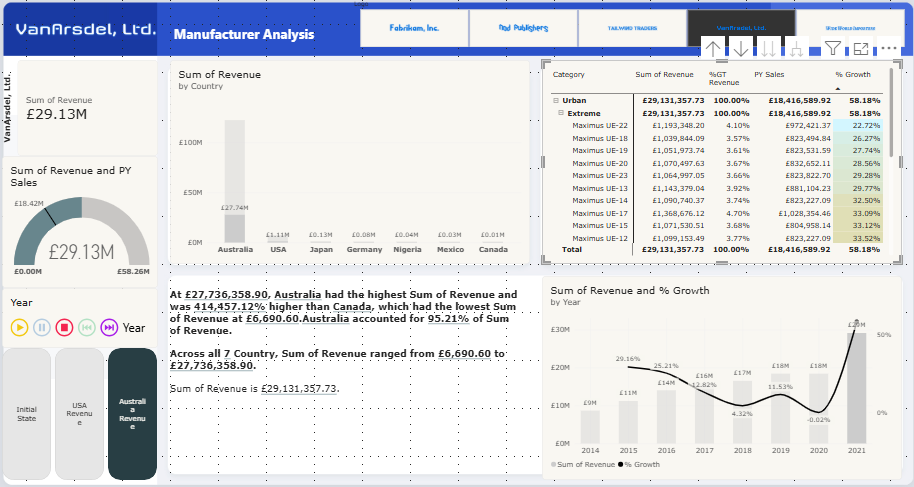

# Manufacturer Analysis — Power BI

I created this dashboard during Microsoft Dashboard in a Day training, using the supplied VanArsdel sample data and guided training material. This is a training project in my Power BI learning portfolio.

## Dashboard preview

## What I worked on

- Bringing sales, product, manufacturer, geography and date information together in a model.
- Comparing revenue with previous-year sales and calculating percentage growth.
- Building a product hierarchy matrix and a revenue breakdown by country.
- Using manufacturer and year slicers to explore the report.
- Adding bookmarks for the initial view, USA revenue and Australia revenue.
- Combining KPI cards, a gauge, charts and a narrative on one report page.

## What the screenshot shows

In this view, revenue is **£29.13 million**, compared with **£18.42 million** in previous-year sales, giving **58.18% growth**. Australia accounts for approximately **£27.74 million** of the selected revenue. These figures relate to the sample data and the filters used in this screenshot.

## What I learned

This exercise helped me understand how the date table and its relationships affect previous-year comparisons. I also practised choosing the right aggregation when displaying revenue as a percentage of the grand total.

## About the files

I have shared a screenshot of the dashboard here. The PBIX and source dataset are not included. The preview is a static image, so the filters and bookmarks cannot be used on GitHub.

## Training credit

Built during **Microsoft Dashboard in a Day** using the supplied **VanArsdel training data and guided exercises**. The sample data, branding and training material are credited to their respective owners.
